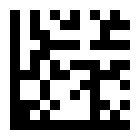
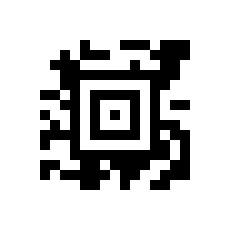

# Barcode encoding from text to pixels

Worked QR, Data Matrix and Aztec examples using this repository's unchanged encoders and GIF writer. The six posts follow input characters through codewords, error correction, module placement and rendering, then check the rendered files with an independent decoder.





All three images decode to `ABC123`. Across 28 recorded cases, 23 recover the exact input and expected symbology. Five deliberate probes demonstrate known encoding limitations. Every generated GIF matches its recorded module map pixel for pixel.

## Read the series

1. [From text to a verified barcode](posts/01-barcode-encoder.md)
2. [How QR turns character pairs into a masked symbol](posts/02-barcode-qr-codewords-and-masks.md)
3. [How Data Matrix packs triples and places codewords](posts/03-barcode-data-matrix-packing-and-placement.md)
4. [How Aztec builds words around a central finder](posts/04-barcode-aztec-modes-and-layers.md)
5. [How module coordinates become GIF pixels](posts/05-barcode-rendering-modules-to-gif.md)
6. [What independent decoding proves and where the encoder fails](posts/06-barcode-independent-decoding-and-limits.md)

[Read the journal edition on forit.us](https://forit.us/journal/barcode-encoder). Open `proof/index.html` locally for a visual companion with the intermediate values and module maps.

## Reproduce the evidence

Use Deno 2.8.3 and Python 3.9 or later. From the proof-series branch:

```sh
git clone --branch docs/barcode-proof-series https://github.com/GaramondAcres/barcode-encoder.git
cd barcode-encoder
deno check mod.ts examples/prove.ts
deno run --allow-read --allow-write=proof examples/prove.ts
python3 -m venv .venv
.venv/bin/pip install -r examples/requirements.txt
.venv/bin/python examples/decode.py
```

The runner checks SHA-256 hashes of the original TypeScript modules against `examples/source-manifest.json` before claiming the pinned source revision `55aa1da55456318be29a125d7c48ad1c0772184c`. No original encoder module has been changed. It records the actual Reed–Solomon calls, exports coordinates once per instance, and writes GIFs through `Canvas`. Initial private TypeScript fields are inspected only by this diagnostic runner.

`proof/traces.json` contains inputs, initial representations, field parameters, data/parity codewords, complete module rows, dimensions and hashes. `proof/verification.json` records the independent reader version, decoded bytes, symbology, pixel equality and hash checks. `examples/decode.py` exits nonzero if an intended success fails or any image differs from its trace. The five explicitly labeled limitation probes are reported separately, never counted as successful round trips.

## Current API limits

- QR capacity overflow returns empty codewords instead of an error. Serialization mutates internal state; construct fresh instances for independent runs.
- Data Matrix's exported `Encoding` constants do not match the encoder's accepted mode values (`0x10`–`0x13`). Its ASCII mode strips high bits, and X12 substitutes spaces for unsupported characters.
- Data Matrix's `getEdgeLength()` omits part of the full geometry. Use `moduleSqd * (edgeLength + 2) + 2` from `symbolInfo` for a complete square canvas with its quiet zone.
- Aztec's binary path consumes JavaScript code units rather than UTF-8 bytes. Arbitrary Unicode round trips are not established.
- These regression cases do not establish print quality, damaged-symbol recovery or exhaustive standards conformance.

See Part 6 for observed failure inputs and decoded outputs. The figures are executable evidence, not a replacement for input validation or comprehensive encoder tests.

## License

MIT; see [LICENSE](LICENSE).
