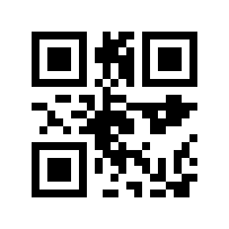

# How module coordinates become GIF pixels

Part 5 of 6. Render the encoders’ coordinates, preserve their geometry and inspect the image bytes that an independent reader actually sees.

Encoding finishes when the message and structural patterns have module positions. Rendering begins when those positions become pixels. The repository separates these responsibilities: QR, DataMatrix and AztecCode return coordinates; Canvas draws a monochrome frame and serializes it as a GIF. The proof uses that Canvas rather than substituting another barcode generator.

## Filter the coordinates and scale by an integer

Each Coord contains x, y and isDark. Some encoders emit both dark and light entries. Canvas.draw and drawSquare paint black, so blindly drawing every coordinate can turn white modules black. The renderer must filter for isDark first. The flag named isModule is used by BarcodeCanvas to distinguish function entries, but the QR export currently emits every final cell through setDataModule; it cannot be treated as a reliable universal structural label.

```text
const symbol = new QR("ABC123", 1);
const coords = symbol.getCoords(); // capture once
const scale = 10;
const canvas = new Canvas(29 * scale, 29 * scale);

for (const coord of coords) {
  if (coord.isDark) {
    canvas.drawSquare({
      x: coord.x * scale,
      y: coord.y * scale,
    }, scale);
  }
}

const gif = canvas.toByteArray();
```

The example uses the QR dimensions established in Part 2. Data Matrix needs the full region-and-border calculation from Part 3. Aztec receives an explicit display margin before scaling. An integer scale keeps every module the same size. The stored GIFs use ten pixels per module and no interpolation; shrinking them with arbitrary resampling can blur a clean black-and-white boundary.

## Write a monochrome raster

Canvas initializes its frame with palette index 1, which is white by default. Drawing writes index 0 for black. Pixel (x, y) has array position y × width + x. A module at grid position (4, 4), for example, occupies pixels x = 40 through 49 and y = 40 through 49 when the scale is ten. This is the complete geometric transformation; no font or text rasterizer is involved.

```text
Logical modules       Canvas.frame          GIF file
0 means light         1 means white         palette entry 1 = FF FF FF
1 means dark          0 means black         palette entry 0 = 00 00 00

QR:          29 × 10 = 290 pixels per side
Data Matrix: 14 × 10 = 140 pixels per side
Aztec:       23 × 10 = 230 pixels per side
```

## Serialize the frame

toByteArray writes the GIF87a signature, little-endian dimensions, a two-color global palette and an image descriptor. Its LZW writer starts with a minimum code size of 2, clear code 4 and end-of-information code 5. Dictionary codes compress repeated pixel sequences, and the output is divided into GIF data sub-blocks before the final 3B trailer. Compression changes the file bytes; it must not change any pixel.

```text
QR GIF prefix
47 49 46 38 37 61   "GIF87a"
22 01               width  = 0x0122 = 290
22 01               height = 0x0122 = 290
80 00 00            logical screen flags and background
00 00 00            black palette entry
FF FF FF            white palette entry
```



The QR GIF emitted by the repository’s own Canvas. The independent check reads these compressed image bytes, rather than decoding the in-memory coordinates.

## Check pixels before checking the message

The proof writes the same module map as a plain PBM image. Pillow opens the GIF, expands the PBM by nearest-neighbor scaling and compares every grayscale pixel. All 28 generated GIFs match their corresponding module maps, including the five cases whose encoded messages are wrong or unreadable. This separates a correct renderer from an incorrect or lossy encoding path.

ZXing-C++ then decodes the GIF and compares both the detected symbology and exact bytes with the original UTF-8 input. Twenty-three round trips pass. The files also have SHA-256 hashes in the trace, which let another run verify it produced the same tested artifacts. A rendered image, a pixel comparison and a successful decode answer different questions; keeping all three makes failures easier to locate.

## Sources and evidence

- [lib/Coord.ts](https://github.com/GaramondAcres/barcode-encoder/blob/55aa1da55456318be29a125d7c48ad1c0772184c/lib/Coord.ts)
- [lib/Canvas.ts](https://github.com/GaramondAcres/barcode-encoder/blob/55aa1da55456318be29a125d7c48ad1c0772184c/lib/Canvas.ts)
- [lib/BarcodeCanvas.ts](https://github.com/GaramondAcres/barcode-encoder/blob/55aa1da55456318be29a125d7c48ad1c0772184c/lib/BarcodeCanvas.ts)
- [ZXing-C++ Python reader](https://github.com/zxing-cpp/zxing-cpp/blob/master/wrappers/python/README.md)
- [Executable encoding trace](https://forit.us/public/barcode-proof/traces.json)
- [Independent decoder results](https://forit.us/public/barcode-proof/verification.json)

[Series index](../README.md) · [Journal edition](https://forit.us/journal/barcode-rendering-modules-to-gif)
